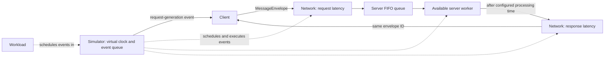

# Discrete-Event Systems Simulator

A small TypeScript simulator for exploring how requests move through a client, a network, and a queued server using **virtual time**. It is a learning and experimentation project: it makes a few systems concepts observable in code without attempting to implement a production HTTP server or a detailed network model.

## Project overview

Discrete-event simulation advances time from one modeled event to the next instead of waiting for real-world time to pass. That makes experiments reproducible and lets you inspect how configured network latency, server processing, worker availability, and queueing affect a request.

This project demonstrates event scheduling, a virtual clock, request/response identity, fixed-interval workload generation, FIFO queueing, a fixed pool of workers, and end-to-end response-time measurement. It is intended for learning TypeScript and experimenting with simplified systems behavior.

## Architecture



- **Workload** schedules each supplied `Message` for the client. The first request is scheduled at the current virtual time; each later request is separated by the configured interval.
- **Client** assigns each outgoing request an ID, records its virtual start time, and forwards a `MessageEnvelope` to the network. On receipt of the matching response, it records and logs the elapsed virtual time.
- **Network** schedules request delivery and response delivery as separate events, each after the same configured latency. It calls `Server.receive` for a request and `Client.receive` for a response.
- **Server** appends incoming envelopes to a FIFO queue. When a worker is available, it takes the oldest queued request and schedules its completion after the configured processing time. Completion creates a response and sends it through the network.
- **Simulator** owns the event list and virtual clock. It repeatedly selects the earliest scheduled event, moves the clock to that event's time, and calls its action. Components use it to schedule future work; no real-time sleeps are involved.

## How the simulator works

### Virtual clock and event scheduling

An `Event` has an absolute virtual `time`, a `name`, and an `action`. `Simulator.schedule` adds an event at its specified time. `Simulator.scheduleIn` computes the event time as the current clock plus the supplied delay.

`Simulator.run` repeatedly sorts the pending event list by time, removes the earliest event, sets the clock to that event's time, logs the time, and executes the action synchronously. An action can schedule more events, which are processed by the same loop. The loop ends when no events remain. Events at the same time execute in insertion order in the current implementation.

### Latency, server work, and queueing

The network models latency by scheduling delivery after a fixed configured delay, both on the request path and on the response path. The server models work by scheduling completion after a fixed processing-time delay. These are virtual delays, not calls to timers or actual network operations.

Each server worker has a busy/available state. The server removes the oldest queued request when it finds an available worker, marks that worker busy, and schedules processing. Once processing completes, the server sends the response, marks the worker available, and tries the queue again. Queue waiting is therefore included in the request's total response time when all workers are busy.

### Workload, identity, and response time

`Workload` accepts an explicit array of messages and a fixed interval. It schedules the first message at delay `0` and increments the delay by the interval for each subsequent message. It does not generate traffic from a probability distribution.

When the client sends a message, the simulator creates a sequential ID in the form `<sender>-<number>` (for example, `Client-1`). A `MessageEnvelope` pairs that ID with the message. The server copies the request envelope's ID onto the response envelope, allowing the client to match the response to the request's recorded start time.

The client measures:

```text
response time = response arrival virtual time - request start virtual time
```

This includes request latency, any server queue wait, processing time, and response latency. The client logs each measurement, retains it by request ID for `getResponseTime`, and removes the corresponding start-time entry after the response arrives. There is no aggregate or percentile calculation.

## Current features

| Area | Implemented behavior |
| --- | --- |
| Event simulation | Virtual clock; absolute event scheduling; relative-delay scheduling; earliest-time-first event execution; insertion order for equal-time events |
| Workload | Schedules a supplied list at a fixed interval, with the first request at the current virtual time |
| Request/response path | Client, network, server queue, server worker, response network delivery, and client receipt |
| Network | One fixed latency value per `Network` instance, applied to both request and response delivery |
| Server capacity | Configured worker count, with worker availability updated as scheduled processing completes |
| Server queue | FIFO queue of request envelopes and their network references |
| Example request handling | `GET /users`, `GET /products`, `GET /orders`, and `POST /users`; unsupported method/route combinations return `404`; an empty or whitespace-only `POST /users` body returns `400` |
| Metrics and output | Per-request end-to-end virtual response time, logged with status code and response data |
| Configuration errors | `ConfigurationError` for negative network latency, negative workload interval, non-positive worker count, or negative processing time |

The constructor parameters for latency, processing time, worker count, and workload interval can be changed in code. The example in `src/index.ts` supplies fixed values for a run; there is no CLI, environment-variable, or configuration-file interface. Constructors throw `ConfigurationError` for the invalid values listed above. The entry point catches and logs a `ConfigurationError` thrown while creating the server, then rethrows it; the other constructor errors are not caught there.

## Project structure

```text
.
├── package.json
├── package-lock.json
├── tsconfig.json
├── SIMULATOR_PROJECT_CHECKPOINT.md
└── src/
    ├── Classes/
    │   ├── Client.ts
    │   ├── Network.ts
    │   ├── Server.ts
    │   └── Workload.ts
    ├── Errors/
    │   └── ConfigurationError.ts
    ├── Tests/
    │   ├── Client.test.ts
    │   ├── Network.test.ts
    │   ├── Server.test.ts
    │   └── Simulator.test.ts
    ├── Types/
    │   ├── Events.ts
    │   ├── Message.ts
    │   └── Receiver.ts
    ├── Simulator.ts
    └── index.ts
```

Generated output (`dist/`) and installed dependencies (`node_modules/`) are intentionally omitted.

`Types/Receiver.ts` defines a `Receiver` interface, but the current simulator flow uses concrete client/network/server methods and does not wire that interface into the request path.

## Requirements and setup

- **Node.js 18 or newer.** `package.json` does not declare an `engines` field; the installed `tsx` dependency declares Node.js `>=18`.
- **npm**, for dependency installation and the package scripts.
- TypeScript is installed as a development dependency (`typescript` `^7.0.2`); a separate global TypeScript installation is not required.

From the project root:

```sh
# Install dependencies
npm install

# Run the simulator in watch mode
npm run dev

# Run the configured test command
npm test

# Run all four test files explicitly
npm run test:all

# Compile TypeScript into dist/
npm run build

# Run the compiled entry point after a successful build
node dist/index.js

# Build and then run the compiled entry point
npm start
```

The development script uses `tsx watch src/index.ts`. The compiler uses `src/` as `rootDir`, emits to `dist/`, and is configured for Node ESM (`NodeNext`). The `test:all` script lists all four test files explicitly. `npm start` compiles the project before running the emitted entry point.

## Testing

Tests use Node.js's built-in `node:test` runner and assertions from `node:assert` / `node:assert/strict`, executed with `tsx`. The test command is `"test": "tsx --test"`.

| Test file | What it covers |
| --- | --- |
| `src/Tests/Simulator.test.ts` | Chronological execution, insertion order for equal-time events, not executing a delayed event before its time, and computing a relative event time from the current virtual clock |
| `src/Tests/Client.test.ts` | Full response-time calculation; request-specific start times and queue-wait contribution; removal of start-time entries after responses |
| `src/Tests/Network.test.ts` | Request delivery at 30 ms and response delivery after a second 30 ms network leg |
| `src/Tests/Server.test.ts` | GET/POST response behavior, empty and whitespace-only POST bodies, unsupported routes/methods, and FIFO processing through a one-worker server |

### Verification status

The network and server tests use the current constructor configuration and pass `MessageEnvelope` values to the server, preserving their original timing, response, and FIFO assertions. The complete test and build status was rechecked after those updates; all test cases and TypeScript compilation succeeded in that verification. The tests cover FIFO behavior with one worker, but do not currently verify concurrent processing with multiple workers or invalid-configuration errors.

## Example simulation

The runnable example is `src/index.ts`. It creates a server with processing time `20`, five workers, a network latency of `30`, and a workload interval of `20`, then schedules seven example messages: three supported GETs, a valid and an empty-body `POST /users`, and two unsupported requests. Run it with:

```sh
npm run dev
```

The example was also run directly with `npx tsx src/index.ts` during this task. A shortened excerpt from that run was:

```text
[t=80ms]
Response time: 80
Status code: 200
Client received: User returned
```

All seven example responses in that observed run had a virtual response time of `80` ms: `30` ms request latency + `20` ms processing + `30` ms response latency. With the example's five workers and 20 ms arrival interval, these requests did not incur queue waiting. The output is written to the console; this is a simulation trace, not measured wall-clock performance.

## Modeling assumptions and limitations

- Time advances only through the simulator's event queue. The project does not use real waiting to represent latency or processing.
- Network latency is one fixed value per network instance and applies equally to request and response delivery.
- Server processing time is fixed per server instance. It is not based on the route, method, or request data.
- Workload arrivals follow a fixed interval over a supplied list; there are no random or irregular arrival models.
- The server implements only the example route/method behavior in `Server.ts`. It is not an HTTP listener and does not communicate with a database or external service.
- Client-side computation is not modeled as a separate stage.
- Response time is recorded per request. Throughput summaries, samples across runs, and p50/p95/p99 latency percentiles are not implemented.
- The model is intentionally simplified; it does not represent packet-level networking, variable latency, or production server behavior.

## Roadmap

The existing project checkpoint describes the following as future work, not current features:

1. Define a deterministic request workload-size field and an operation-based processing-cost model.
2. Test processing costs across operations and workload sizes.
3. Support variable arrival intervals.
4. Add configurable variable or random arrival and service-time models.
5. Collect latency samples and calculate p50, p95, and p99.
6. Run capacity and bottleneck experiments by varying arrival rates, worker counts, and processing costs.

The checkpoint notes that the workload-size representation and processing-cost configuration have not been finalized. None of these roadmap items are described here as implemented.

## Learning and design principles

The project emphasizes virtual time rather than real waiting, incremental implementation, deterministic tests for modeled behavior, and learning through controlled experiments. Its current design keeps the event loop and components small instead of adding abstractions before they are needed. The existing tests and checkpoint reflect these goals, although some test files need to be brought up to date with the current APIs before the full suite can serve as a passing regression baseline.
